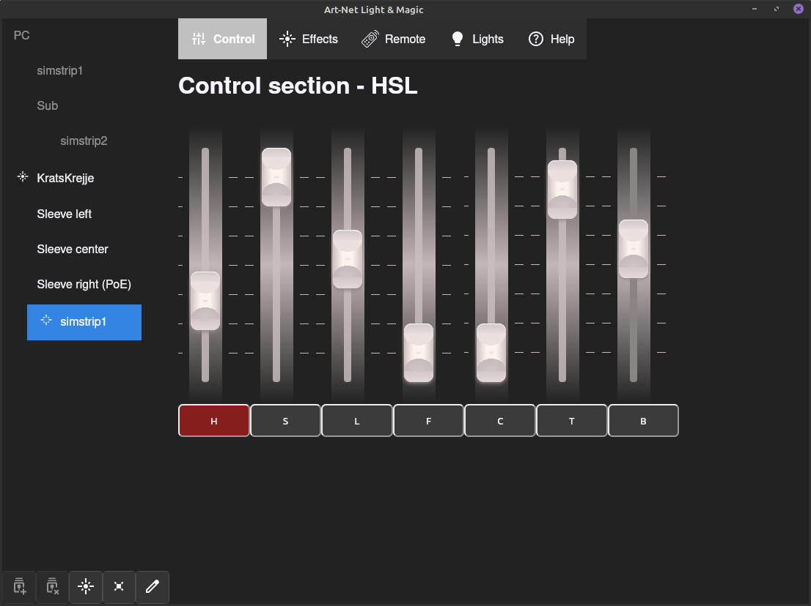
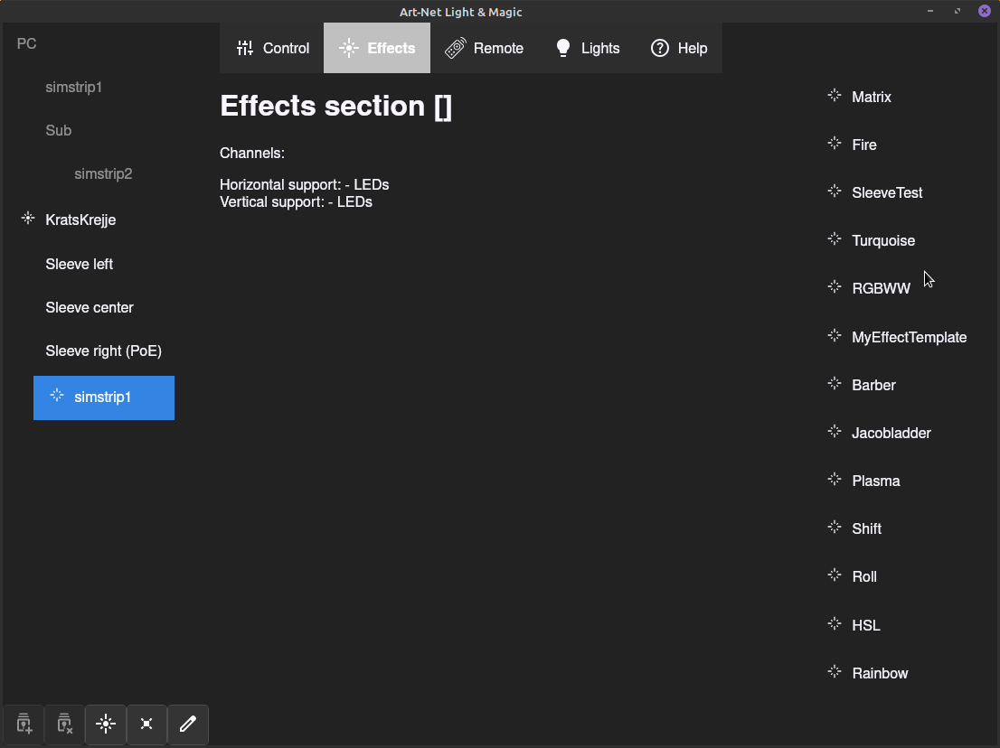
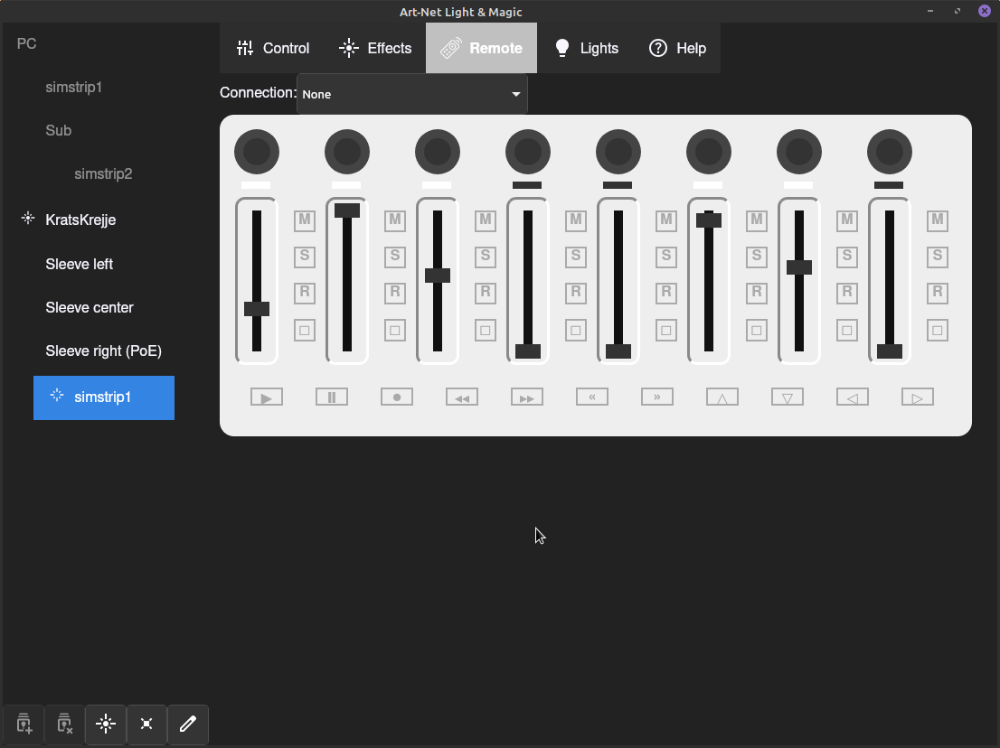
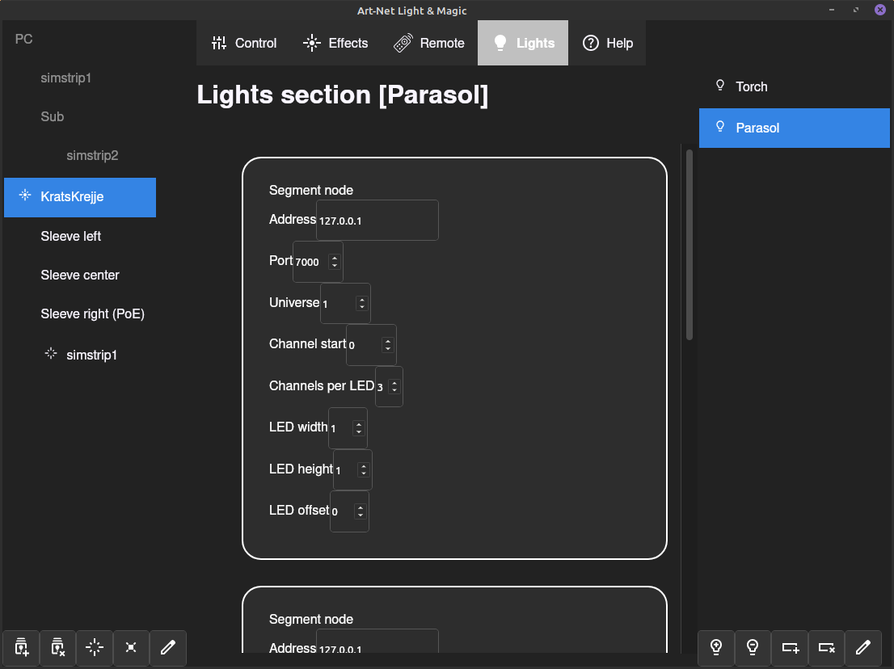

# Art-Net Light & Magic (ALM)

**Note that the current codebase is in early alpha state.**

This program is designed to control multiple lights in an easy way.
It allows dropping effects (animations) onto a defined treelist of light segments that can contain multiple LEDs.

Currently, Art-Net is supported on a strip or grid of colored LEDs where each color is a single channel within the Art-Net packet.

Initially, a custom made LED sleeve was supported but Art-Net enabled [WLED](https://kno.wled.ge/) setups and likely other devices are also supported.

Effects can have value channels that can be controlled either from the Control tab or wirelessly by an 8-channel M-VAVE SMC mixer.

The list of effects can be expanded easily by writing TypeScript (or Javascript if one prefers)

## Application (ALM-controller)
The application consists of several segments used to select and control effects for certain (groups of) lights.

The left tree control will contain light segments, optionally within a hierarchy to easily control multiple lights at once.

An item (group or segment) will be enabled when an effect is (indirectly) applied to it.

If an effect is directly applied and active, it will display a closed "sparkle"; if the item is a group item, all the effects ans subgroups under it will have this effect applied.

At the bottom of the tree control there are several buttons:

* **Add child light group** \
This will create a new group as a child under the selected group

* **Remove light group** \
This will remove the selected group and all its descendants from the list

* **Toggle effect** \
This will activate or deactivate the current effect on the selected item and its descendants. When deactivated, the item and its descendants will inherit the effect from its ancestor

* **Remove effect** \
This will remove the current effect from the selected item and its descendants.
The item and its descendants will inherit the effect from its ancestor, similar to toggle, except permanently

* **Rename group** \
This allows one to rename the selected group item

### Control tab
This tab is the single most important tab on your party.
It controls the *channels* of the effect for the selected item and its descendants, if they have the same effect applied.


From the picture, you're able to see that *simstrip1* is selected, has a disabled effect applied and is therefore inheriting the effect from *Kratskrejje*.
*Kratskrejje* and its descendants have the *HSL* (Hue, Saturation, Lightness) applied, where you currently see the control settings of *simstrip*:

* channel 1 is muted (red) by having the *H* button clicked.
* channel 2 is at its maximum channel value
* channel 4 and 5 are at its mimimum value
* ...etc.

Don't worry about the single character channel labels; it will be covered in Effects.

With a touch screen you're able to slide multiple channel faders simultaneously, allowing you to be a virtuoso of some sorts, without the need of external hardware.

### Effects tab
This tab allows you to read up on an effect's details and enables you to drag-drop an effect on the right hand side to a segment or group on the left hand side, immediately activating this effect.



### Remote tab
This tab is dedicated to external hardware: The 
bluetooth 8-channel M-VAVE SMC mixer.

From here, you're able to connect to the device and see the current status of the hardware.
When clicking/tapping on a control or button, you're able to apply an application action which enables you to:
* select a segment or group item for further control
* emit a channel value of a certain index
* mute/unmute a certain channel
* set/remove an effect on an item
* toggle effect


Currently these actions are hardcoded and this is a work in progress.

### Lights tab
From here you can set up your lights that are to be deployed in the tree control on the left hand side.
For Art-Net, this includes:
* **IP address and port** \
  network destination
* **Universe** \
  Art-Net universe, up to 65k supported per IP/port
* **Channel start** \
  offset within Art-Net packet; at which DMX channel the effect starts
* **Channels per LED** \
  typically 3: red+green+blue, but dimmer, warm/cold, RGBW, RGBWW and RGBCCT is also taken into account for some effects
* **LED width** \
  horizontal amount of LEDs
* **LED height** \
  vertical amount of LEDs


The example image displays a parasol light with 3 segments (its spokes, duplicated) where each spoke (and its mirror image) is one segment that can be controlled individually when dropped onto the light group.

Currently this tab is a work in progress and is more or less indicative of a user's light arsenal.

## Effects
Effects are the light animation that will fill an entire (Art-Net) universe.
Channels within the effect can influence the effect real-time by controlling it with either the *Control* tab or connecting a *Remote* M-VAVE SMC mixer.

Channels will have a name/description and a short character indicator displayed on the mute button.

### Current effects and it description
* **Barber** \
  A well known barber pole. \
  Channels: **P**alette
* **Fire** \
  Famous OHM2013 animation, originally written by Prodigity \
  Channels: **P**alette, particle **C**ount, **H**eat
* **HSL** \
  Hue, Saturation, Lightness (and other helpful variables) \
  Channels: **H**ue, **S**aturation **L**ightness, **F**lash speed, flash **C**urve, **T**op start, **B**ottom end
* **Jacobladder** \
  Mad scientist arc effect \
  No channels
* **Matrix** \
  Falling matrix rain effect \
  Channels: **P**alette, **F**oreground speed, **B**ackground speed
* **MyEffectTemplate** \
  Template code for writing your own effect.
* **Plasma** \
  Channels: **P**alette, **B**lock size, **S**peed
* **Rainbow** \
  Slow cycling rainbow \
  No channels (yet)
* **RGBWW** \
  Light channel effect \
  Channels: maps to every channel within a light segment; all LEDs within the segment will carry the same color.
* **Roll** \
  Color band roll left/right \
  Channels: **P**alette, **B**andwidth/type, **S**peed/direction
* **Shift** \
  Color band shift up/down \
  Channels: **P**alette, **B**andwidth, **S**peed/direction
* **SleeveTest** \
  Light tester, Work in progress, currently drawing blue dots on the left side, red dots on the bottom side and a green dot on the top right side of an OHM2013 LED sleeve \
  No channels (yet)
* **Turqoise** \
  Light tester, used for checking correct RGB alignment of the lights \
  Channels: **V**alue/intensity

### Creating custom effects
You can implement a new Effect in 2 ways: stand-alone and subclass from a helper.

In either case, give your class a `description`, `channels` info and `renderDelay`. Provide channel value handlig in `onWindowMessage` type `"channels"` and implement your `frame` function.


#### Stand-alone

This is the simplest example: for every `frame` call, you fill the `data` ArrayBuffer according to the segment's channels (typically `RGBRGB...`)

An example / template can be found at *MyEffectTemplate.ts* and *Turquoise.ts*.


#### Subclassing

This is the recommended way: to make use of several helper functions, the `Effect` base class is available.

The base class might get extra helpers in the future.

Simple examples can be found at *Jacobladder.ts* and *SleeveTest.ts*.


## Simulator (simdev)

For local visual feedback (debugging, and possibly in the future, adding screens to the setup), one can run `npm run dev:simdev`
(or `./apps/simdev/src-tauri/target/debug/simdev` or `./apps/simdev/src-tauri/target/release/simdev`)

By default, it listens on port 7000 (like the OHM2013 simstrip), but this can be altered by appending the port number:
`./apps/simdev/src-tauri/target/release/simdev 6454`

Move the window by dragging with the finger or mouse, and close it by pressing alt+F4 or right click on the taskbar and choose close.


## Development / bugfixing

### Prerequisites
* System dependencies:
`sudo apt install webkitgtk3-devel libgtk-3-dev libsoup-3.0-dev javascriptcoregtk-4.1-dev`

* [Rust](https://rustup.rs/)

* Optionally [VS Code](https://code.visualstudio.com/) and extensions:
  * [Tauri](https://marketplace.visualstudio.com/items?itemName=tauri-apps.tauri-vscode)
  *  [rust-analyzer](https://marketplace.visualstudio.com/items?itemName=rust-lang.rust-analyzer)

* Optionally [linuxdeploy](https://github.com/linuxdeploy/linuxdeploy.git) to bundle an appimg.


### Run / debug
`npm run dev:controller`

### Maintenance
TODO
```
npm update

npm outdated

npm install vite@latest

cargo add tauri@2.11.1
cargo add tauri-plugin-fs@2.5.1
```

### Troubleshooting

#### Dark mode not applied
There seems to be an [issue](https://github.com/tauri-apps/wry/issues/884) where a dark mode desktop is not recognized.


Best way to circumvent is to first read the theme name: `gtk-query-settings gtk-theme-name`, use this value to determine whether it ends on "dark", and append `:dark` to it.
Assign it to the correct environment variable, for example:
`GTK_THEME=Mint-L-Dark-Purple:dark`

Other methods like editing `~/.config/gtk-3.0/settings.ini` or use gsettings on `org.gnome.desktop.interface color-scheme` weren't fruitful.

